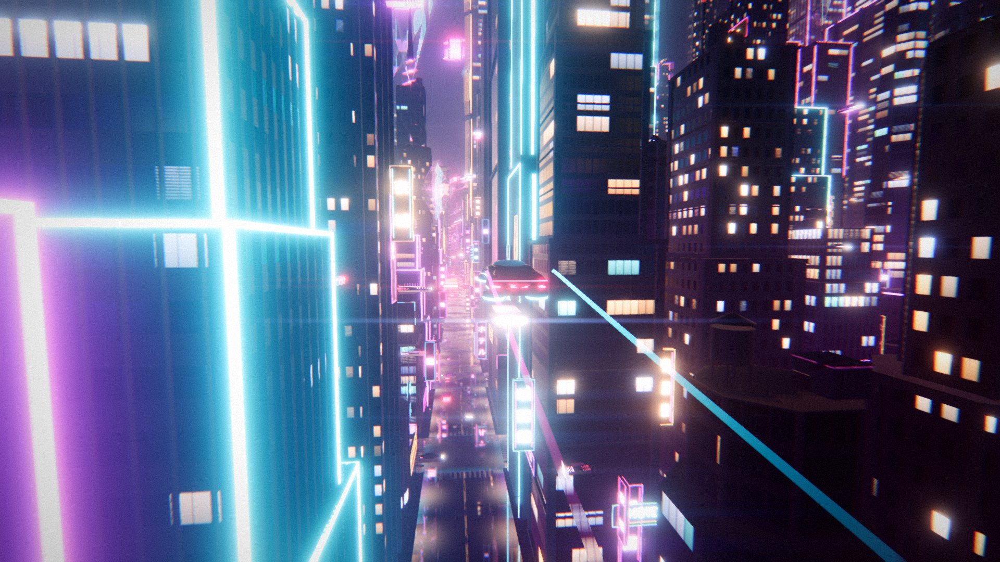
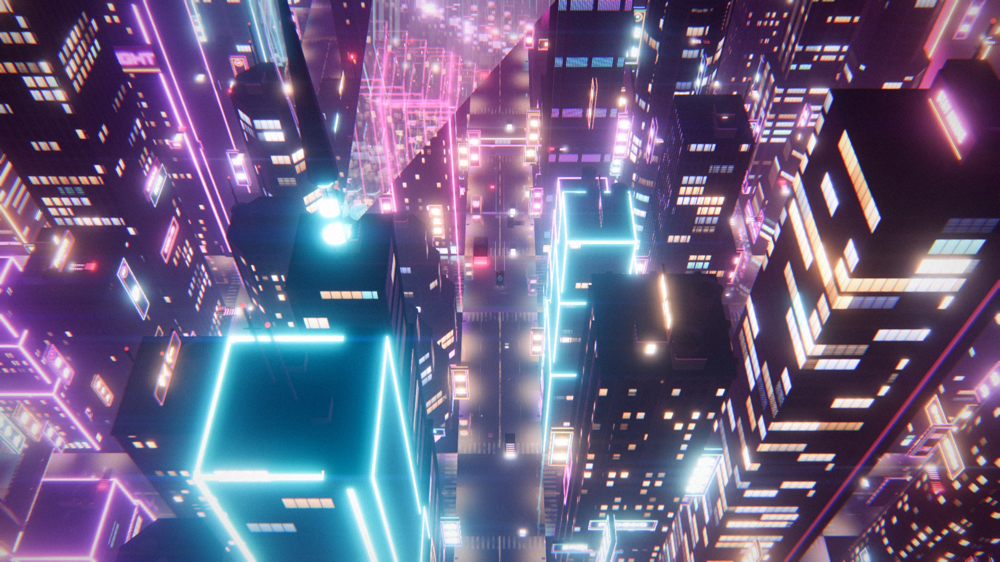
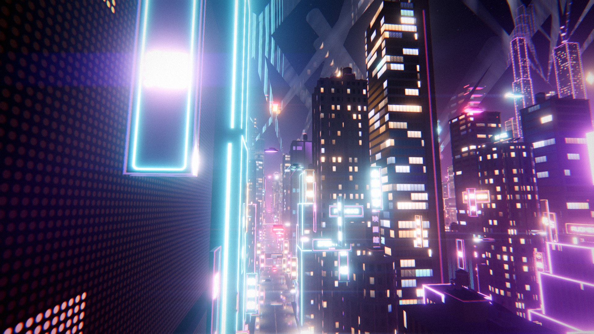
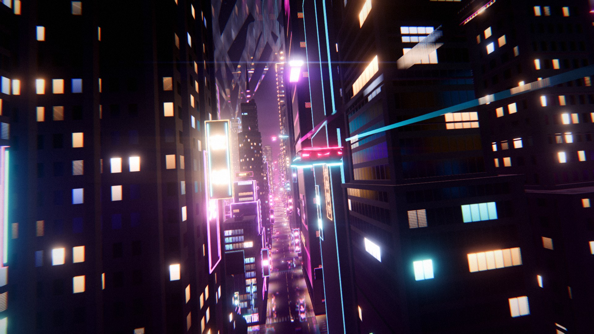
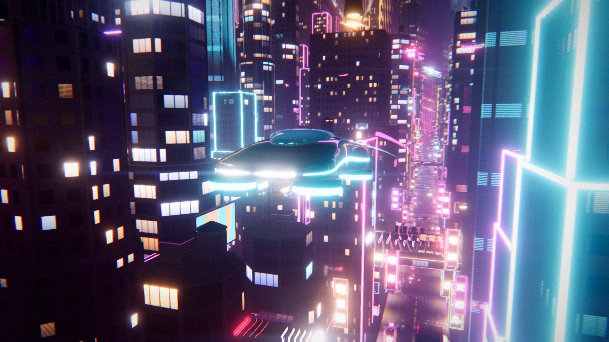
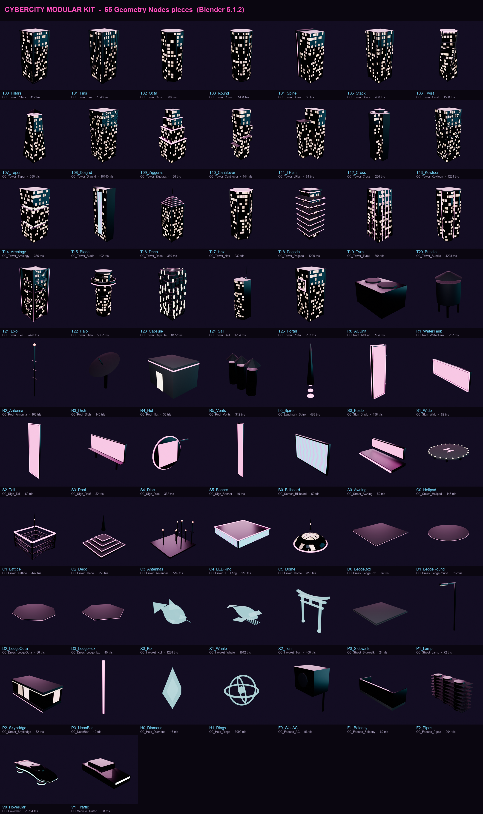
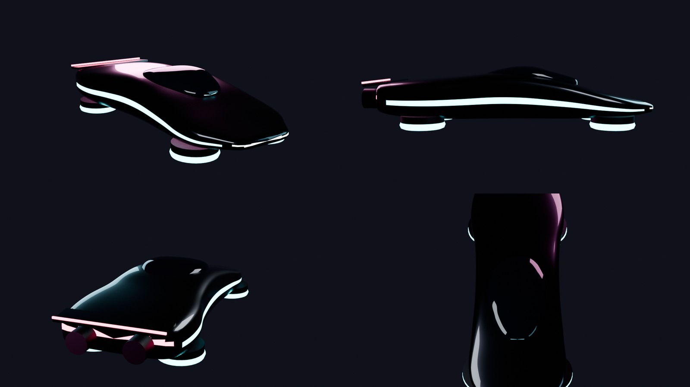
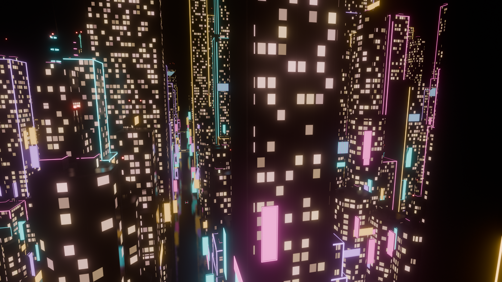

# NEO//KYOTO — an infinite procedural neon city

**Blender Geometry Nodes → Python pipeline → Three.js WebGPU.**
A cyberpunk megacity authored as Geometry Nodes in Blender, exported by a headless Python pipeline (modular kit + every slider of the node tree), and rebuilt live, *infinitely*, in the browser with Three.js `WebGPURenderer` and TSL, while a procedural hover car tears through the street canyons.



| | |
|---|---|
|  |  |
|  |  |

---

## Quick start

```bash
npm install
npm run dev          # http://localhost:5173
```

You start **at the controls** of the hover car (`?cinematic` starts on the auto-directed film instead, `?kiosk` hands back to it after 30 s idle).

| Key | |
|---|---|
| `W` `S` / `↑` `↓` | throttle / brake & reverse |
| `A` `D` / `←` `→` | steer (banks into the turn) |
| `SPACE` / `E`, `Q` / `CTRL` | climb, descend |
| `SHIFT` | boost |
| `V` | pilot camera: chase → wide → cockpit → hood |
| `F` | first-person cockpit ⇄ chase cam |
| mouse drag / wheel | look around the car / zoom |
| gamepad | RT/LT throttle, left stick steer, right stick altitude, A boost |
| `C` | fly yourself ⇄ cinematic director |
| `O` | free orbit camera |
| `1`–`8` / `N` | jump to a cinematic shot / next shot |
| `G` | control panel (every Blender slider lives here) |
| `H` | hide UI, for clean captures |
| `R` | record video (MP4/H.264 when supported, else WebM, 40 Mbps) |
| `P` | save a PNG still |

URL parameters: `?seed=42` · `?look=Synthwave` (`Neon Noir`, `Replicant Amber`, `Synthwave`, `Akira Red`, `Ghost Shell`) · `?shot=flyby` · `?dpr=1.5` (fixed resolution, disables dynamic resolution) · `?radius=4` (view distance in chunks).

> **Windows laptops:** Chrome often picks the integrated GPU for WebGPU. Set Chrome to *High performance* in *Settings → System → Display → Graphics* to run on the discrete GPU.

---

## The pipeline

```
 blender/build.py ──► cybercity.blend ──► blender/export.py ──► public/assets/
   │  gn.py        (Python DSL that writes Geometry Nodes trees)     ├─ kit.glb        25 modular pieces, modifiers applied
   │  materials.py (22 roles, window-grid shader group)              ├─ car.glb        the KX-11 hover car
   │  kit.py       (25 GN generators: towers, roofs, signs…)         ├─ manifest.json  node-group interfaces = the sliders,
   │  car.py       (procedural bmesh hover car + cockpit)            │                 current values, materials, palette
   │  city.py      (CC_CityGenerator + CC_Rand)                      └─ parity.json    every instance GN produced
   │
   └─ npm run assets   (finds Blender, runs both stages headless)       npm run parity  ← JS port == Geometry Nodes
```

```bash
npm run assets            # rebuild the .blend and re-export (Blender 4.2+; developed on 5.1)
npm run assets -- --render # + EEVEE press renders: docs/blender_city.png, car_sheet.jpg, kit_sheet.png
npm run parity            # verify the browser layout matches Blender's evaluated instances
```

### 1 · Everything in Blender is Geometry Nodes

`blender/gn.py` is a small DSL that writes node trees from Python, auto-lays them out and groups them into labelled frames, so the `.blend` stays readable and editable by an artist:

```python
g = GN("CC_Tower_Fins")
g.inp("Fins Per Side", "INT", 9, 0, 24, panel="Shape")
fin = g.transform(g.cube(g.vec(g.p("Fin Width"), fd, 1.0)), t=g.vec(0, g.sub(-0.48, g.mul(fd, 0.5)), 0.5))
side = g.realize(g.instance(g.mesh_line(n, (-0.42, 0, 0), g.vec(step, 0, 0)), fin))
```

* **Modular kit** (`kit.py`): 26 tower archetypes on a unit footprint (windows are *shaded*, so non-uniform scaling never stretches them) — from pillars, fins and diagrids to a flared-eave pagoda, a stepped Tyrell pyramid, bundled tubes, an exoskeleton, a halo-ring drum, a Nakagin-style capsule tower, a curved sail and a sky-portal slab — each merged with a Mesh Boolean union so no faces are coplanar. Plus 6 roof props, a landmark spire, 6 sign types, an LED billboard, facade clutter, street pieces, 2 rooftop holograms, a traffic car, the runtime dressing set (4 ledge profiles, 6 rooftop crowns, a shop awning) and hologram art (koi, whale, torii gate). Each piece is its own node group with exposed inputs.



* **Hover car** (`car.py`, `npm run car` rebuilds just the car in ~20 s): the KX-11 Kestrel, a long Spinner-style sedan generated with bmesh. A station-table loft (subdivided, with creased sponson and shoulder character lines) whose top is dished into a real **cockpit tub**, a wraparound glass canopy, a long roof slab with a panoramic glass panel, side thruster nacelles and four ducted hover pads. Panel gaps, light bars, vents and neon lines are snapped onto the subdivided body with BVH ray casts. Inside: bucket seats, dashboard, steering yoke, console and three screens whose UVs map to a live canvas (`CockpitScreens.js`: speed/altitude cluster, moving street map, radio). Mount points (driver's eye, nozzles, trails, lamps) travel to the web build as glTF extras.


* **City** (`city.py` → `CC_CityGenerator`): 33 inputs in panels *Grid / Skyline / Massing / Details / Palette / Preview*: block grid, lots, mega-blocks, district value-noise, landmarks, stepped setback tiers, neon trims, roofscape, facade signs, LED billboards, skybridges sized against both towers, street lamps, holograms. `Preview Origin X/Y` lets Blender show **any window of the infinite city**.



### 2 · The same city, bit for bit

Every random decision goes through one node group, `CC_Rand`, which uses Blender's own Random Value node with a fixed id/seed scheme (`id = X·Mult + K`, `seed = Y·64 + channel + Seed·7919`). `src/city/blenderHash.js` is an exact port of Blender's Jenkins lookup3 hash, verified empirically:

```
FLOAT  = hash_to_float(seed, id)        INT = min + hash(id, seed) % (max − min + 1)
```

`src/city/layout.js` is a line-by-line port of `city.py` that rounds to float32 at the same places Geometry Nodes does. `npm run parity` compares it against the instances Blender evaluated:

```
Blender instances : 9231
JS instances      : 9231
matched           : 9231  (worst relative matrix error 5.0e-5)
PARITY OK - the browser builds the same city as Geometry Nodes.
```

It also holds 7,600 km from the origin with another seed and grid (`--set "Seed=421;Preview Origin X=-1537;Preview Origin Y=88412;Lots Per Side=3"`).

### 3 · Sliders travel with the data

`manifest.json` carries each node group's interface (name, type, range, panel, description) and the modifier values at export time. The web control panel (`G`) is **generated** from it: same names, same ranges, same panels as Blender's modifier tab. Moving *Height Max* or *Seed* in the browser re-runs the GN-exact layout and restreams the city.

---

## The renderer (Three.js r186, WebGPU + TSL)

* **Infinite streaming** (`CityStreamer.js`): 4×4-block chunks generated on demand, packed into **one `InstancedMesh` per kit piece** (~25 draw calls for ~45k instances). Translations are stored per chunk in float64 and rebased onto a floating origin, so precision holds anywhere. Detail props stream in a tighter ring.
* **One TSL uber-material** for the whole city (`ArchitectureMaterial.js`). The Blender material slot becomes a per-vertex `aRole`, and the generator's shading data a per-instance `aInst`:
  * windows in world space: office grids, ribbon glazing, apartments; rooms, blinds, TV flicker, broken fluorescents; moiré-free distance filtering
  * street-level shopfronts, rare animated LED media facades
  * neon tubes with flicker/breathing, a runtime neon sign atlas (Noto Sans JP / Monoton / Orbitron), 8 LED billboard programmes (synthwave sun, plasma, spectrum, data rain…)
* **GPU traffic**: ~2,600 cars across four lane levels with zero CPU cost; position is a pure function of `instanceIndex` and time. Custom motion vectors make their lights streak.
* **Dressing** (`Dressing.js`): reads the GN layout back per lot and adds what must be in metres instead of stretched with the tower: floor-aligned cornice ledges with lit lips, rooftop crowns (helipads, steel lattices, art-deco steps, antenna farms, LED crown rings, domes) and street awnings with shop signs. The pieces are GN generators in `kit.py`; the parity-checked layout is untouched.
* **No Z-fighting**: reversed-Z float32 depth (uniform precision from 0.25 m to 4 km), every tower's parts merged with a Mesh Boolean union in Geometry Nodes (no coplanar caps/crowns), neon trims lifted off the roof plane.
* **3D holograms** (`HoloArt.js`): GN koi schools circling intersections and whales cruising above the skyline (vertex-shader swimming), torii-gate tunnels over the streets (fly through them), a giant kitsune fox running across the sky and a 70 m dancing robot in the canyons (skinned glTF). Plus floating video panels, neon type and generated holo-posters (`PosterAtlas.js`, fictional brands) in `HoloLayer.js`.
* **Atmosphere**: analytic height fog tinted by the sky, light-polluted clouds, wet asphalt with puddles, lane paint and fake light pools, GPU rain, sweeping searchlights from landmark roofs, holograms.
* **Hero car**: first-person cockpit camera (`F`) with free look, tinted canopy glass that clears from the inside, physical clearcoat/iridescent plum paint, a dedicated reflection environment that rotates with distance travelled (neon sliding over the body), headlight spot + underglow, exhaust plumes, twin light trails.
* **Post stack** (`Post.js`): MRT (beauty, velocity, view normals, reflect mask) → half-res **SSR** on wet streets → camera motion blur → mip bloom + depth-weighted *haze* bloom + anamorphic streaks → chromatic aberration → ACES → contrast/saturation/split-tone grade → SMAA/FXAA → sharpen → vignette + grain. Every stage is adjustable from the ⚙ Settings panel (saved per browser).
* **Cinematic director**: 8 shots (pursuit, low angle, head-on, tracking, fly-by, overhead, establishing crane, orbit). Cameras ahead of the car sit on the autopilot's future path, so they never clip into buildings. The autopilot plans turns and altitude and dives **under the skybridges** that GN placed on its street.
* **Dynamic resolution** keeps the frame rate up on unknown hardware. Dev builds also expose `__app.shot(name, warm, w, h)`, which renders any resolution offscreen and saves a PNG to `captures/` through a Vite endpoint.

## Project layout

```
blender/   gn.py materials.py kit.py car.py city.py build.py export.py render_*.py
src/       main.js looks.js
  city/      blenderHash.js layout.js Kit.js CityStreamer.js Dressing.js
  media/     VideoAtlas.js PosterAtlas.js
  materials/ ArchitectureMaterial.js SignAtlas.js HoloMaterial.js palette.js velocity.js
  world/     Atmosphere.js Ground.js Traffic.js Rain.js Searchlights.js HoloLayer.js HoloArt.js Wires.js
  vehicle/   HoverCar.js Autopilot.js PlayerFlight.js Trail.js
  camera/    Director.js     post/ Post.js     ui/ Gui.js Capture.js
scripts/   pipeline.mjs parity.mjs fetch-media.mjs kit_sheet.py
```

## Third-party media (all free for commercial use, with attribution)

| Asset | Licence |
|---|---|
| *Tears of Steel* excerpts — Blender Foundation, mango.blender.org | CC BY 3.0 |
| *Sintel* excerpts — Blender Foundation, durian.blender.org | CC BY 3.0 |
| Deep-sea jellyfish footage — NOAA Office of Ocean Exploration and Research (via Wikimedia Commons) | Public domain |
| Black-hole accretion disk — NASA Goddard Space Flight Center / Jeremy Schnittman | Public domain (NASA) |
| `Fox.glb` — model PixelMannen (CC0), rigging & animation tomkranis (CC BY 4.0), glTF conversion @AsoboStudio & @scurest (CC BY 4.0), from KhronosGroup/glTF-Sample-Assets | CC0 / CC BY 4.0 |
| `RobotExpressive.glb` — Tomás Laulhé (Quaternius), modifications Don McCurdy, from the three.js examples | CC0 |

Everything else (city, kit, car, koi, whales, torii, signs, posters) is generated by this project. The in-app credits line shows the attributions while running.
